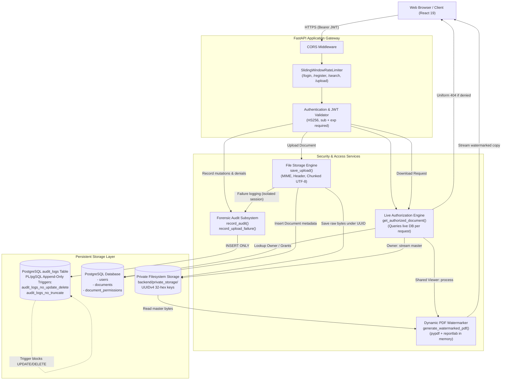

# TrustVault — Architecture Documentation

**Project:** TrustVault — Secure Role-Based Document Sharing & Audit Platform  
**Target:** Snovasys Fresher Hiring Challenge 2026  
**Live Frontend:** [https://trustvault-ui-obkw.onrender.com](https://trustvault-ui-obkw.onrender.com)  
**Live Backend:** [https://trustvault-back.onrender.com](https://trustvault-back.onrender.com)  
**Current Branch:** `main` | **Head Commit:** `59d7883`

---

## 1. System Overview & Technology Stack

TrustVault is an enterprise-grade document sharing platform built upon strict defense-in-depth principles: zero-trust server-side authorization on every transaction, discretionary access control (DAC) with per-document permissions, private server-side file storage, traceable dynamic PDF watermarking, and an append-only audit trail protected by database triggers.

### Core Technology Stack

```
┌────────────────────────────────────────────────────────────────────────┐
│                        CLIENT / PRESENTATION                           │
│  - React 19 (TypeScript, Vite 8 build tool)                            │
│  - Tailwind CSS v4 styling with curated navy & slate enterprise palette│
│  - React Router DOM v7 (protected routes, role-based guards)           │
│  - Axios HTTP client with centralized interceptors & 401 handling      │
│  - Lucide React icon library                                           │
└───────────────────────────────────┬────────────────────────────────────┘
                                    │ HTTPS REST / Bearer JWT
                                    ▼
┌────────────────────────────────────────────────────────────────────────┐
│                    API GATEWAY & APPLICATION SERVER                    │
│  - FastAPI (Python 3.11+, running on Uvicorn ASGI server)              │
│  - Pydantic v2 schemas for strict input validation & sanitization      │
│  - Thread-safe sliding-window in-memory rate limiting                  │
│  - PyJWT for HMAC-SHA256 (HS256) stateless token validation            │
│  - pwdlib with Argon2id for password hashing                           │
└──────────────┬────────────────────┬────────────────────┬───────────────┘
               │                    │                    │
               ▼                    ▼                    ▼
┌──────────────────────┐  ┌──────────────────┐  ┌──────────────────────┐
│ AUTHORIZATION ENGINE │  │ STORAGE & WATERMARK│  │ FORENSIC AUDIT TRAIL │
│ - Live DB queries    │  │ - UUIDv4 hex keys │  │ - PostgreSQL triggers│
│ - Zero token-caching │  │ - Magic signature │  │   preventing UPDATE,  │
│ - Uniform 404 on     │  │   inspection      │  │   DELETE, TRUNCATE   │
│   inaccessible docs  │  │ - pypdf/reportlab │  │ - Independent DB     │
│                      │  │   memory watermark│  │   session on upload  │
│ (authorization.py)   │  │ (file_storage.py) │  │   validation failure │
└──────────────┬───────┘  └─────────┬────────┘  └──────────┬───────────┘
               │                    │                      │
               ▼                    ▼                      ▼
┌────────────────────────────────────────────────────────────────────────┐
│                        PERSISTENCE & STORAGE                           │
│  - PostgreSQL 15+ relational database (managed with SQLAlchemy 2.0)    │
│  - Alembic transactional schema migrations                             │
│  - Private local filesystem storage (never exposed as static web root) │
└────────────────────────────────────────────────────────────────────────┘
```

---

## 2. Mermaid Architecture & Data Flow Diagram



---

## 3. Subsystem Breakdown

### 1. Presentation & State Management Layer (`frontend/src/`)
- **Framework:** React 19 + TypeScript bundled via Vite 8.
- **Routing & Guards:** React Router DOM v7 with `ProtectedRoute.tsx` enforcing authenticated sessions and role requirements (`requiredRole="admin"` for audit inspection).
- **Authentication Context:** `AuthContext.tsx` stores JWT tokens in `localStorage`, injects Bearer authorization headers via Axios request interceptors, and clears tokens upon HTTP 401 responses.
- **In-Browser Document Preview:** `DocumentViewer.tsx` renders authenticated PDF documents with client-side anti-framing and security overlays.

### 2. Application & API Gateway Layer (`backend/app/main.py`)
- **FastAPI Core:** Provides RESTful routing, dependency injection (`Depends(get_db)`, `Depends(get_current_user)`), and OpenAPI schema generation.
- **CORS Middleware:** Configured with origins in `default_origins` and dynamically extended via the `CORS_ORIGINS` environment variable.
- **Rate Limiting:** Managed by thread-safe `SlidingWindowRateLimiter` instances in [`app/rate_limiter.py`](file:///d:/projects/trustvault/backend/app/rate_limiter.py):
  - `/auth/login`: 10 requests per 60 seconds per IP.
  - `/auth/register`: 5 requests per 60 seconds per IP.
  - `/users/search`: 30 queries per 60 seconds per user/IP.
  - `/documents/upload` and bulk sharing: 30 requests per 60 seconds per user.

### 3. Authentication & Security Engine ([`app/security.py`](file:///d:/projects/trustvault/backend/app/security.py))
- **Password Protection:** Uses Argon2id via `pwdlib` (`PasswordHash.recommended()`). Plaintext passwords are never stored or logged.
- **Registration Validation:** `UserRegister` in [`app/schemas.py`](file:///d:/projects/trustvault/backend/app/schemas.py) validates passwords (minimum 8 characters, at least 1 uppercase letter, 1 lowercase letter, 1 digit, and 1 special character).
- **Token Cryptography:** JWTs signed with `HS256`. Enforces `len(JWT_SECRET) >= 32` at application startup. Decoding strictly requires `sub` and `exp` claims.
- **Active Status Check:** `get_current_user()` verifies the user exists in PostgreSQL and `user.is_active is True`.

### 4. Discretionary Access Control Engine ([`app/authorization.py`](file:///d:/projects/trustvault/backend/app/authorization.py))
- **Server-Side Evaluation:** `get_authorized_document()` queries the live database on every request.
- **Rule Hierarchy:**
  1. If `document.owner_id == user.id`: Document owner has full read and edit rights.
  2. If `permission.permission_type == "edit"`: User can read and update document metadata.
  3. If `permission.permission_type == "read"` and required permission is `"read"`: User can view and download watermarked copy.
  4. Platform Administrator alone has **NO** implicit access to private document contents unless granted explicit permission by the owner.
- **Information Leakage Defense:** If a document is missing or the caller lacks an active grant, the engine uniformly raises `HTTP 404 Not Found` (rather than 403) to prevent document existence enumeration.

### 5. Private File Storage Engine ([`app/file_storage.py`](file:///d:/projects/trustvault/backend/app/file_storage.py))
- **Storage Location:** Private directory `backend/private_storage/` outside the web root; never mounted as a static directory.
- **Storage Keys:** Random 32-hex UUIDv4 strings (`uuid4().hex`). Client-supplied filenames are never used as filesystem paths.
- **Ingestion Validation:**
  - 10 MB maximum file size (`MAX_FILE_SIZE = 10 * 1024 * 1024`), enforced by chunked streaming (64 KB).
  - Magic byte binary signatures (`%PDF-`, `\x89PNG\r\n\x1a\n`, `\xff\xd8\xff`).
  - Incremental UTF-8 validation with null byte (`\x00`) rejection across stream boundaries for `.txt` files.
  - Path traversal sequences (`../`, null bytes) sanitized from filenames.
  - Partial files immediately unlinked from disk upon upload failure.

### 6. Dynamic Traceable PDF Watermarking ([`app/watermark.py`](file:///d:/projects/trustvault/backend/app/watermark.py))
- **Memory-Only Processing:** Uses `pypdf` (6.21.2) and `reportlab` (5.1.0) to stamp viewer identity in-memory without altering the original master file in private storage.
- **Watermark Payload:**
  - Authenticated viewer's full name and email: `John Doe (john@example.com)`
  - Explicit UTC generation timestamp: `2026-10-25 12:00:00 UTC`
  - Document ID and unique trace reference: `TRC-42-A1B2C3D4`
  - Page index and confidentiality notice: `CONFIDENTIAL • FOR AUTHORIZED USE ONLY`
- **Fail-Closed Policy:** Corrupt or encrypted PDFs fail closed with HTTP 422 Unprocessable Entity. Non-PDF shared downloads fail closed with HTTP 422 because watermarking is PDF-specific.

### 7. Forensic Append-Only Audit Trail ([`app/audit.py`](file:///d:/projects/trustvault/backend/app/audit.py), [`app/models.py`](file:///d:/projects/trustvault/backend/app/models.py))
- **Coverage:** Records logins, failed logins, rate limit violations, uploads, failed uploads, previews, downloads, metadata updates, permission grants, bulk grants, revocations, deletions, and access denials.
- **Database Trigger Defense:** PostgreSQL PL/pgSQL function `prevent_audit_log_mutation()` combined with triggers `audit_logs_no_update_delete` and `audit_logs_no_truncate` block any SQL `UPDATE`, `DELETE`, or `TRUNCATE` operations on `audit_logs`.
- **Upload Failure Persistence:** `record_upload_failure()` in [`app/routers/documents.py`](file:///d:/projects/trustvault/backend/app/routers/documents.py) spins up an independent `SessionLocal()` to record validation rejections even when the primary request transaction aborts.

---

## 4. Concrete End-to-End Execution Flows

### A. Document Upload Flow

```
User (Owner/Admin)           FastAPI Gateway              Storage & Database
      │                             │                             │
      ├── POST /documents/upload ──►│                             │
      │   (multipart/form-data)     ├── Check rate limit (30/min) │
      │                             ├── Check role in {owner,admin│
      │                             ├── save_upload() ───────────►│
      │                             │   - sanitize filename       │── Check magic bytes
      │                             │   - stream 64KB chunks      │── Enforce <= 10MB
      │                             │   - generate UUIDv4 key     │── Write to private_storage/
      │                             │◄── return key, name, size ──│
      │                             ├── Insert Document model ───►│
      │                             ├── record_audit() ──────────►│
      │                             ├── db.commit() ─────────────►│ Persist atomically
      │◄── 201 Created (JSON) ──────┤                             │
      │                             │                             │
  [Failure Path]                    │                             │
      │                             ├── Ingestion error ─────────►│ destination.unlink()
      │                             ├── record_upload_failure() ─►│ SessionLocal() commit
      │◄── 413 / 415 / 422 ─────────┤                             │
```

### B. Document Download Flow (Owner vs. Shared Viewer)

```
User                         FastAPI Gateway              Authorization & Storage
  │                                 │                                │
  ├── GET /documents/{id}/download ─►│                                │
  │                                 ├── get_current_user() (JWT)     │
  │                                 ├── Check live DB authorization ─►│ SELECT * FROM documents
  │                                 │   - Missing / unshared?        │   LEFT JOIN permissions
  │                                 │     -> Raise 404 & audit denial│
  │                                 │◄── Document authorized ────────┤
  │                                 │                                │
  │  [Case 1: Caller is Owner]      │                                │
  │                                 ├── Resolve storage path ───────►│ Read master file
  │                                 ├── Audit success ──────────────►│ Commit audit row
  │◄── 200 OK (Original File) ──────┤                                │
  │                                 │                                │
  │  [Case 2: Caller is Shared]     │                                │
  │                                 ├── Check if PDF? (if not: 422)  │
  │                                 ├── generate_watermarked_pdf() ─►│ Overlay viewer identity,
  │                                 │   (in memory via pypdf)        │ UTC time, trace reference
  │                                 ├── Audit success ──────────────►│ Commit audit row
  │◄── 200 OK (Watermarked PDF) ────┤                                │
```

### C. Permission Revocation Flow

```
Document Owner               FastAPI Gateway              Database & Storage
      │                             │                             │
      ├── DELETE /permissions/{uid}►│                             │
      │                             ├── Verify caller is owner ──►│ SELECT owner_id
      │                             │   (if not: 404 & audit)     │
      │                             ├── db.delete(permission) ───►│ DELETE FROM permissions
      │                             ├── record_audit() ──────────►│ INSERT INTO audit_logs
      │                             ├── db.commit() ─────────────►│ Commit transaction
      │◄── 204 No Content ──────────┤                             │
      │                             │                             │
[Revoked User Next Request]         │                             │
      ├── GET /documents/{id} ─────►│                             │
      │                             ├── get_authorized_document()►│ SELECT * FROM permissions
      │                             │   No active grant found!    │ (Returns None)
      │                             ├── record_audit(denied) ────►│ INSERT INTO audit_logs
      │◄── 404 Not Found ───────────┤                             │
```

---

## 5. Server-Side Security Invariants

| Security Domain | Client-Side Responsibility (Presentation Only) | Server-Side Responsibility (True Security Boundary) |
|---|---|---|
| **Authentication** | Stores token in `localStorage`, clears on 401 | Decodes JWT, validates HMAC signature, checks expiration, verifies active status in PostgreSQL |
| **Authorization** | Hides or disables UI action buttons based on user role | `get_authorized_document()` verifies live database ownership/grants on every request |
| **Document Existence** | Redirects to 404 page if API returns 404 | Uniformly returns HTTP 404 for unshared and nonexistent documents |
| **File Validation** | File input accepts `.pdf, .txt, .png, .jpg` | Enforces 10 MB limit, inspects binary signatures, performs chunked UTF-8 validation |
| **Watermarking** | CSS watermark overlay in `DocumentViewer.tsx` | Stamps physical PDF bytes in-memory before transmission; master file on disk remains clean |
| **Audit Logging** | None | Append-only triggers in PostgreSQL reject `UPDATE`, `DELETE`, `TRUNCATE` from application |
