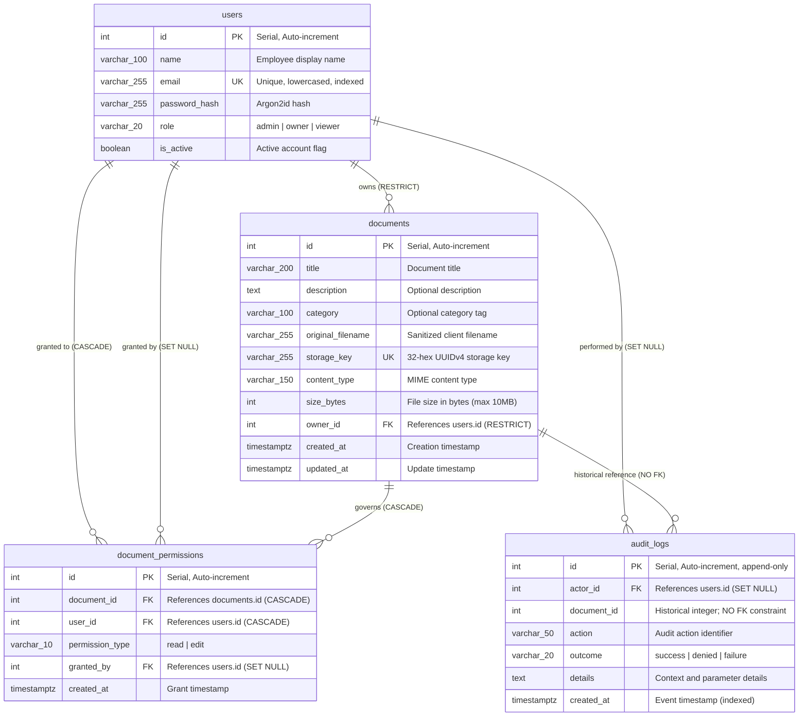

# TrustVault — Database Architecture & Schema Documentation

**Project:** TrustVault — Secure Role-Based Document Sharing & Audit Platform  
**Target:** Snovasys Fresher Hiring Challenge 2026  
**Engine:** PostgreSQL 15+  
**Dialect / Driver:** `postgresql+psycopg` (psycopg3)  
**ORM:** SQLAlchemy 2.0  
**Migration Framework:** Alembic (Head Revision: `d7a2c9e4b105`)

---

## 1. Database Entity-Relationship (ER) Diagram



---

## 2. Table Specifications & Constraints

### 2.1 `users` Table ([`app/models.py:20-62`](file:///d:/projects/trustvault/backend/app/models.py#L20-L62))
Stores user identity, credentials, and platform capability roles.

| Column | Data Type | Nullable | Default | Constraints & Indexes |
|---|---|---|---|---|
| `id` | `INTEGER` | No | Auto-increment | Primary Key, Indexed |
| `name` | `VARCHAR(100)` | No | — | — |
| `email` | `VARCHAR(255)` | No | — | Unique, Indexed |
| `password_hash` | `VARCHAR(255)` | No | — | Argon2id hash string |
| `role` | `VARCHAR(20)` | No | `'viewer'` | Check: `role IN ('admin', 'owner', 'viewer')` |
| `is_active` | `BOOLEAN` | No | `TRUE` | Deactivated accounts blocked at login |

### 2.2 `documents` Table ([`app/models.py:64-95`](file:///d:/projects/trustvault/backend/app/models.py#L64-L95))
Stores metadata for uploaded documents. Physical files are stored in `backend/private_storage/`.

| Column | Data Type | Nullable | Default | Constraints & Indexes |
|---|---|---|---|---|
| `id` | `INTEGER` | No | Auto-increment | Primary Key, Indexed |
| `title` | `VARCHAR(200)` | No | — | Display title |
| `description` | `TEXT` | Yes | `NULL` | Optional summary |
| `category` | `VARCHAR(100)` | Yes | `NULL` | Category tag |
| `original_filename` | `VARCHAR(255)` | No | — | Sanitized original client filename |
| `storage_key` | `VARCHAR(255)` | No | — | Unique, 32-hex UUIDv4 disk filename |
| `content_type` | `VARCHAR(150)` | No | — | Validated MIME type |
| `size_bytes` | `INTEGER` | No | — | File size in bytes (max 10,485,760) |
| `owner_id` | `INTEGER` | No | — | Foreign Key: `users.id` (`ondelete="RESTRICT"`), Indexed |
| `created_at` | `TIMESTAMPTZ` | No | `func.now()` | Creation timestamp |
| `updated_at` | `TIMESTAMPTZ` | No | `func.now()` | Automatic on-update timestamp |

### 2.3 `document_permissions` Table ([`app/models.py:97-135`](file:///d:/projects/trustvault/backend/app/models.py#L97-L135))
Stores granular access grants between documents and users.

| Column | Data Type | Nullable | Default | Constraints & Indexes |
|---|---|---|---|---|
| `id` | `INTEGER` | No | Auto-increment | Primary Key, Indexed |
| `document_id` | `INTEGER` | No | — | Foreign Key: `documents.id` (`ondelete="CASCADE"`) |
| `user_id` | `INTEGER` | No | — | Foreign Key: `users.id` (`ondelete="CASCADE"`) |
| `permission_type` | `VARCHAR(10)` | No | — | Check: `permission_type IN ('read', 'edit')` |
| `granted_by` | `INTEGER` | Yes | `NULL` | Foreign Key: `users.id` (`ondelete="SET NULL"`) |
| `created_at` | `TIMESTAMPTZ` | No | `func.now()` | Grant creation timestamp |

- **Table Constraints:**
  - `UniqueConstraint("document_id", "user_id", name="uq_document_permission_user")`: Guarantees at most one active grant per user per document.

### 2.4 `audit_logs` Table ([`app/models.py:137-171`](file:///d:/projects/trustvault/backend/app/models.py#L137-L171))
Stores tamper-evident forensic records of all system operations.

| Column | Data Type | Nullable | Default | Constraints & Indexes |
|---|---|---|---|---|
| `id` | `INTEGER` | No | Auto-increment | Primary Key, Indexed |
| `actor_id` | `INTEGER` | Yes | `NULL` | Foreign Key: `users.id` (`ondelete="SET NULL"`), Indexed |
| `document_id` | `INTEGER` | Yes | `NULL` | Unconstrained Integer, Indexed (No FK constraint) |
| `action` | `VARCHAR(50)` | No | — | Action name (e.g. `document_upload`, `login`) |
| `outcome` | `VARCHAR(20)` | No | — | Check: `outcome IN ('success', 'denied', 'failure')` |
| `details` | `TEXT` | Yes | `NULL` | Context, reason, or failure parameters |
| `created_at` | `TIMESTAMPTZ` | No | `func.now()` | Indexed timestamp for range queries |

---

## 3. Append-Only Triggers & Immutability Architecture

### 3.1 Migration `c4e1a8b29f70`: Database-Level Trigger Protection
Application code restrictions alone cannot prevent tampering if an attacker executes raw SQL via an injection vulnerability or compromised database credentials. TrustVault moves write protection into PostgreSQL PL/pgSQL triggers:

```sql
CREATE OR REPLACE FUNCTION public.prevent_audit_log_mutation()
RETURNS trigger LANGUAGE plpgsql AS $$
BEGIN
    RAISE EXCEPTION 'audit_logs are append-only';
END;
$$;

CREATE TRIGGER audit_logs_no_update_delete
BEFORE UPDATE OR DELETE ON public.audit_logs
FOR EACH ROW EXECUTE FUNCTION public.prevent_audit_log_mutation();

CREATE TRIGGER audit_logs_no_truncate
BEFORE TRUNCATE ON public.audit_logs
FOR EACH STATEMENT EXECUTE FUNCTION public.prevent_audit_log_mutation();
```

- Any SQL `UPDATE`, `DELETE`, or `TRUNCATE` query executed against `audit_logs` raises an uncatchable exception: `audit_logs are append-only`.
- Verified by automated tests in `tests/test_audit_integrity.py`.

### 3.2 Migration `d7a2c9e4b105`: Decoupling Document Deletion from Audit Retention
In early revisions, `audit_logs.document_id` had a foreign key constraint referencing `documents.id` with `ON DELETE SET NULL`. 

When an owner deleted a document, PostgreSQL executed an `UPDATE` on `audit_logs` to set `document_id = NULL`. Because the append-only trigger intercepted and aborted all `UPDATE` queries, document deletion failed!

Migration `d7a2c9e4b105` solved this architectural conflict:
- Dropped the foreign key constraint: `ALTER TABLE audit_logs DROP CONSTRAINT audit_logs_document_id_fkey;`.
- Kept `audit_logs.document_id` as an unconstrained, indexed integer column.
- Result: When a document is deleted, the document is removed from active storage while historical audit rows remain untouched, preserving the original numeric `document_id` forever.

---

## 4. Alembic Migration History & Commands

Migrations are strictly managed with Alembic. `Base.metadata.create_all()` is never used in production or seed scripts.

### 4.1 Migration Tree
```text
fa9d3cc8788d (create_users_table)
       │
       ▼
96d86a251001 (add_documents_permissions_and_audit_logs)
       │
       ▼
c4e1a8b29f70 (protect_audit_log - PL/pgSQL triggers)
       │
       ▼
d7a2c9e4b105 (preserve_audit_document_ids - Head Revision)
```

### 4.2 Migration Commands
```bash
cd backend

# Apply all migrations to the latest revision:
alembic upgrade head

# Inspect the currently applied migration revision:
alembic current

# View full migration history:
alembic history --verbose

# Roll back by one migration step (if needed):
alembic downgrade -1
```

---

## 5. Security & Immutability Boundaries

| Boundary Level | Tamper-Proofing Guarantee | Limit / Disclaimer |
|---|---|---|
| **Application Layer** | Application routes only execute `INSERT` and `SELECT` queries on `audit_logs`. | Depends on application code integrity. |
| **Application Role (`trustvault_app`)** | PostgreSQL triggers block `UPDATE`, `DELETE`, and `TRUNCATE`. | Protected against SQL injection and application credential compromise. |
| **Database Superuser (`postgres`)** | None. A PostgreSQL superuser can run `ALTER TABLE audit_logs DISABLE TRIGGER ALL;` or drop the table. | Absolute protection against superusers requires hardware WORM (Write-Once-Read-Many) storage. |
