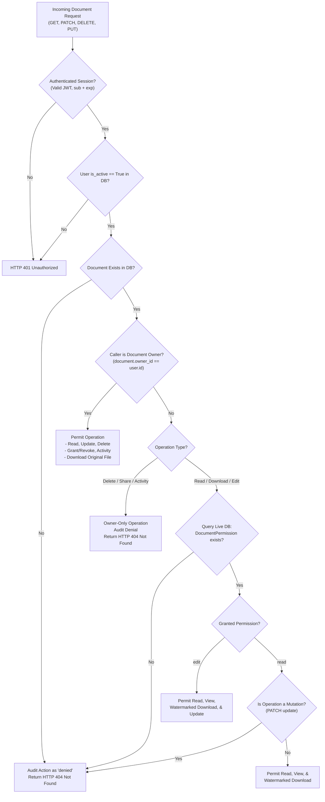

# TrustVault — Permissions & Role-Based Access Control

**Project:** TrustVault — Secure Role-Based Document Sharing & Audit Platform  
**Target:** Snovasys Fresher Hiring Challenge 2026  
**Security Model:** Discretionary Access Control (DAC) with Strict Zero-Trust Server Enforcement

---

## 1. Role Definitions & System Capabilities

TrustVault distinguishes between three system roles (`admin`, `owner`, `viewer`) defined in [`app/models.py:24-28`](file:///d:/projects/trustvault/backend/app/models.py#L24-L28):

### 1.1 `admin` (Platform Administrator)
- **Primary Responsibility:** System oversight, compliance monitoring, and forensic audit log inspection.
- **Administrative Endpoints:** Sole role permitted to query `GET /admin/audit-logs`.
- **Document Creation & Sharing:** Permitted to upload PDF documents and manage access to documents they personally created (commit `59d7883`).
- **CRITICAL ZERO-TRUST BOUNDARY:** **Administrator status alone does NOT grant access to other users' private documents!** If an administrator attempts to read, download, or edit a document owned by another user without an explicit grant, the server returns **HTTP 404 Not Found**. Administrators cannot bypass discretionary access controls.

### 1.2 `owner` (Document Owner / Creator)
- **Primary Responsibility:** Document management and discretionary access control.
- **Document Ingestion:** Can upload PDF, TXT, PNG, and JPG documents (up to 10 MB).
- **Ownership Scope:** Controls lifecycle for documents where `document.owner_id == user.id`.
- **Exclusive Capabilities:**
  - Update document metadata (`PATCH /documents/{id}`).
  - Delete document and its storage file (`DELETE /documents/{id}`).
  - Grant individual `read` or `edit` permissions to active employees (`PUT /permissions/{uid}`).
  - Revoke individual permissions (`DELETE /permissions/{uid}`).
  - Bulk share document with all active employees (`POST /permissions/bulk`).
  - Bulk revoke all shared permissions (`DELETE /permissions/bulk`).
  - Download unwatermarked original master files from storage (`GET /documents/{id}/download`).
  - Inspect document access and download history (`GET /documents/{id}/activity`).

### 1.3 `viewer` (Employee / Document Recipient)
- **Primary Responsibility:** Consuming shared documents granted by document owners.
- **Creation Restrictions:** Cannot upload files (`POST /documents/upload` returns HTTP 403).
- **Access Restrictions:** Cannot view, list, or search documents unless granted explicit permission by an owner.
- **Management Restrictions:** Cannot delete documents, cannot grant permissions, cannot bulk share, and cannot view audit logs.

---

## 2. Granular Per-Document Permissions (`read` vs. `edit`)

When a document owner shares a document, they assign one of two permission types ([`app/models.py:130-134`](file:///d:/projects/trustvault/backend/app/models.py#L130-L134)):

| Permission Type | In-Browser Viewing (`/view`) | Secure Download (`/download`) | Metadata Update (`PATCH`) | Delete & Share Management |
|---|---|---|---|---|
| **`read`** | Allowed (Secure stream) | Allowed (Dynamically watermarked PDF) | **Denied (HTTP 404)** | **Denied (HTTP 404)** |
| **`edit`** | Allowed (Secure stream) | Allowed (Dynamically watermarked PDF) | **Allowed** | **Denied (HTTP 404)** |
| **`owner`** (implicit) | Allowed (Secure stream) | Allowed (Original master file) | **Allowed** | **Allowed** |

---

## 3. Mermaid Permission Evaluation Flowchart



---

## 4. Immediate Revocation Lifecycle

Permissions in TrustVault are evaluated against live database records on every request. Permissions are **never** cached inside JWT payloads or Redis memory caches.

```
Time T0: Document Owner grants User B 'read' access.
         User B calls GET /documents/42 -> Returns 200 OK.

Time T1: Document Owner revokes User B's access via DELETE /permissions/UserB.
         PostgreSQL deletes the row in an atomic transaction and commits.

Time T2: User B makes an immediate subsequent call GET /documents/42
         using their existing, cryptographically valid JWT.
         Authorization engine queries live database: no grant found!
         Server audits denial and immediately returns HTTP 404 Not Found.
```

---

## 5. Denied Operations & Status Code Matrix

| Caller Role / State | Attempted Operation | Returned Status Code | Server Behavior & Audit Action |
|---|---|---|---|
| **Unauthenticated** | Any protected endpoint | `401 Unauthorized` | Rejected by OAuth2 scheme; WWW-Authenticate header returned. |
| **Viewer** | `POST /documents/upload` | `403 Forbidden` | Audited as `action="document_upload", outcome="denied"`. |
| **Viewer / Owner** | `GET /admin/audit-logs` | `403 Forbidden` | Audited as `action="admin_audit_logs_read", outcome="denied"`. |
| **Ungranted Viewer** | `GET /documents/{id}` | `404 Not Found` | Uniform 404 prevents document existence disclosure; audited as denial. |
| **Ungranted Viewer** | `GET /documents/{id}/download` | `404 Not Found` | File path never resolved; audited as denial. |
| **Viewer (`read`)** | `PATCH /documents/{id}` | `404 Not Found` | Reader cannot update metadata; audited as denial. |
| **Editor (`edit`)** | `DELETE /documents/{id}` | `404 Not Found` | Non-owner cannot delete document; audited as denial. |
| **Editor (`edit`)** | `PUT /permissions/{uid}` | `404 Not Found` | Non-owner cannot manage access; audited as denial. |
| **Platform Admin** | `GET /documents/{id}` (unshared) | `404 Not Found` | Admin status does not grant document access; audited as denial. |
| **Document Owner** | `PUT /permissions/{self_id}` | `400 Bad Request` | Owner cannot grant access to self (`"You already own this document"`). |
